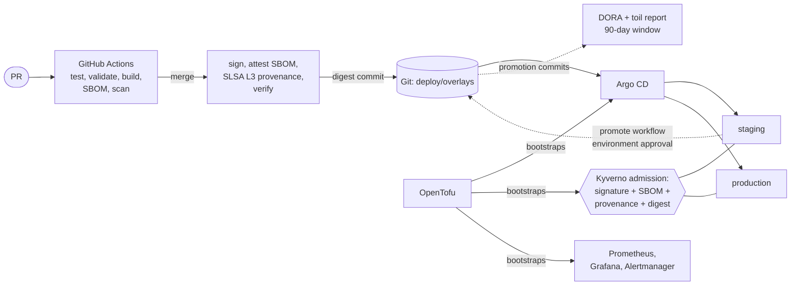

# HealthQueue delivery pipeline

A reference DevOps pipeline that takes a small service from pull request to
production on Kubernetes. Features:

- **supply-chain security aligned with SLSA Build L3**
- **GitOps with Argo CD**
- **platform bootstrap with OpenTofu**
- **SBOMs**
- **SLO-based observability**
- **DORA metrics with toil-reduction recommendations**

The full stack runs on a Windows laptop.

The service, `healthqueue-api`, estimates emergency-department wait times
from aggregate triage inputs. It is deliberately small, because the pipeline
is the product.



## Quick start (Windows)

```powershell
# Prerequisites: Git, Node 24+, OpenTofu, kubectl, minikube, Docker Desktop (or Hyper-V)
# winget commands: docs/local-development.md
Set-ExecutionPolicy -Scope Process -ExecutionPolicy Bypass

.\scripts\local\install-tools.ps1      # once: pinned, checksum-verified validation CLIs
.\scripts\check.ps1                    # everything CI checks, offline (~15s)

.\scripts\local\up.ps1                 # minikube + Kyverno + Prometheus stack + Argo CD + app
.\scripts\local\verify.ps1             # end-to-end checks
.\scripts\local\load.ps1 -ErrorPercent 20 -Minutes 15   # watch the burn-rate alert fire
.\scripts\local\down.ps1
```

`up.ps1` defaults to real GitOps: Argo CD syncs your **pushed** branch. Use
`-Mode Direct` to apply your working tree instead. See
[docs/local-development.md](docs/local-development.md).

DORA report from synthetic data, no GitHub needed:

```powershell
node dora/cli.mjs sample --out dora-out; Get-Content dora-out/report.md
```

## What is in the box

| Area | What | Where |
|---|---|---|
| **CI** | Parallel test, manifest, policy and IaC validation; image build; dependency review; CodeQL (code **and** workflows); OpenSSF Scorecard. All actions SHA-pinned, `permissions: {}` by default | [`.github/workflows/`](.github/workflows), [docs/pipeline.md](docs/pipeline.md) |
| **SBOM** | Syft SPDX + CycloneDX from the built image; Grype gate on the SBOM; CycloneDX attached as a signed attestation | `ci.yml` build job, [ADR 0006](docs/adr/0006-sbom-generation.md) |
| **Supply chain** | Keyless cosign signatures; SLSA Build L3 provenance via `slsa-github-generator`; verification in CI **and** at admission (Kyverno); digest-only, trusted-registry policy; distroless non-root image | [docs/supply-chain-security.md](docs/supply-chain-security.md), [`deploy/platform/policies/`](deploy/platform/policies) |
| **SLSA** | Requirement-by-requirement mapping, threats to controls, known gaps | [docs/slsa.md](docs/slsa.md) |
| **OpenTofu** | One platform module (Kyverno, kube-prometheus-stack, Argo CD + Notifications, root app) used by `local` and `production` roots; client-side **encrypted state** in production; provider lock files | [`infra/`](infra), [ADR 0004](docs/adr/0004-opentofu-for-platform-bootstrap.md) |
| **Argo CD** | App-of-apps per cluster; AppProjects separate app and platform; automated sync with self-heal | [`argocd/`](argocd), [ADR 0003](docs/adr/0003-gitops-with-argo-cd.md) |
| **Kubernetes** | Kustomize base + local/staging/production overlays; PSA `restricted`; default-deny NetworkPolicy; PDB, HPA, graceful shutdown | [`deploy/`](deploy) |
| **Promotion** | Verified digest auto-committed to staging; production via an environment-approved, re-verified commit; no bot or GitHub App; rollback = `git revert` | [ADR 0013](docs/adr/0013-promotion-without-a-bot.md), [runbooks/rollback.md](docs/runbooks/rollback.md) |
| **Observability** | Availability (99.5%) and latency (99% at most 300ms) SLOs over 30d; multi-window burn-rate alerts **generated from a spec and unit-tested with promtool**; pipeline SLOs; error budget policy; Grafana dashboard | [docs/observability.md](docs/observability.md), [`observability/`](observability) |
| **DORA** | All five metrics from pipeline-emitted events; rolling window capped at 90 days, 90-day report retention; weekly trend and 30-vs-30-day comparison; ranked toil/flow/stability recommendations with a stated cost model | [docs/dora.md](docs/dora.md), [`dora/`](dora), [sample report](docs/dora/sample/report.md) |
| **Decisions** | 13 ADRs, each with options, trade-offs and revisit triggers | [docs/adr/](docs/adr) |

## Repository layout

```
app/                    Node 24 service (stdlib only), tests, Dockerfile
deploy/
  base/                 Kustomize base: hardened Deployment, Service, HPA, PDB, NetworkPolicy, PSA namespace
  components/monitoring ServiceMonitor, generated SLO PrometheusRule, Grafana dashboard
  overlays/             local | staging | production (+ release.json provenance records)
  platform/             Kyverno policies (+ tests), Argo CD delivery alerts
argocd/                 AppProjects, Applications, per-cluster app-of-apps roots
infra/                  OpenTofu: modules/platform, envs/local, envs/production
observability/          SLO spec (source of truth) and promtool alert tests
dora/                   DORA collector, metric engine, toil analysis, report (zero deps)
scripts/                promote.mjs, SLO rule generator, CI scripts (bash), local scripts (PowerShell)
docs/                   pipeline, SLSA, supply chain, observability, DORA, operations, runbooks, ADRs
```

## Major design decisions and their trade-offs

Each one has a full ADR. In short:

| Decision | We gain | We pay | ADR |
|---|---|---|---|
| GitHub Actions, everything SHA-pinned, least-privilege tokens | Native OIDC for keyless signing; the SLSA L3 generator; no CI to operate | GitHub lock-in; pin-bump PR toil (measured by the DORA report) | [0002](docs/adr/0002-github-actions-hardening.md) |
| Pull-based GitOps with Argo CD, auto-sync everywhere | CI holds no cluster credentials; drift is reverted; "merged" means "deployed" | Another control plane to run; up to 3 min sync latency; emergency `kubectl edit` is reverted by design | [0003](docs/adr/0003-gitops-with-argo-cd.md) |
| OpenTofu bootstraps controllers only; Argo CD owns the rest | Same bootstrap on laptop and cluster; clear ownership; encrypted state | Helm chart versions need manual upgrades; cluster provisioning is out of scope | [0004](docs/adr/0004-opentofu-for-platform-bootstrap.md) |
| Kustomize for the app, Helm for third-party software | Reviewable YAML; promotion is a two-line diff | Verbose patches if environments diverge a lot | [0005](docs/adr/0005-kustomize-over-helm.md) |
| SBOM from the built image, both formats, signed, gating | Covers base-image packages; consumers can trust and use it | ~30s per build; `only-fixed` lets unfixable CVEs through (visible, not blocking) | [0006](docs/adr/0006-sbom-generation.md) |
| Keyless signing + SLSA L3 provenance + admission verification | Unforgeable provenance; fail-closed at the cluster; no keys | Admission depends on Rekor + registry; ClusterPolicy is deprecated in Kyverno 1.19 (migration planned); legacy signature format chosen for compatibility | [0007](docs/adr/0007-signing-provenance-admission.md) |
| Digest promotion: auto to staging, approval-gated to production | Same bytes everywhere; auditable, revertible gate | Promotion jobs push to main; the approval gate adds wait (measured) | [0008](docs/adr/0008-promotion-model.md) |
| DORA from promotion commits + `Source-Revision:` trailers, 90-day cap | Exact lead time; no manual logging; bounded API cost | Deploy time = commit time (Argo CD converges minutes later); failed syncs not counted; time-window incident attribution is a heuristic; no long-term history in-repo | [0009](docs/adr/0009-dora-measurement.md) |
| Burn-rate SLO alerts generated from a spec | Few, meaningful pages; one place states each objective; unit-tested | A small generator to maintain; low-traffic flapping not yet guarded | [0010](docs/adr/0010-slo-burn-rate-alerting.md) |
| Stateless, zero-dependency workload | Minimal attack surface; scales freely; no health data | Hand-rolled metrics; the SBOM is mostly base image; no tracing yet | [0011](docs/adr/0011-stateless-zero-dependency-workload.md) |
| minikube + PowerShell for local | Runs on any Windows 10/11 with or without Docker Desktop; production-like | ~8 GB RAM; bash and PowerShell versions of the checks to keep aligned | [0012](docs/adr/0012-local-development-on-windows.md) |
| No bot: `GITHUB_TOKEN` pushes + GitHub Environment gate | Zero extra accounts, apps or long-lived credentials; works out of the box | Production gate is an approval, not a PR review; a PR-requiring ruleset on `main` needs an optional deploy key | [0013](docs/adr/0013-promotion-without-a-bot.md) |

## Using this for real

Follow [docs/operations.md](docs/operations.md):

1. Replace the owner `umamidayo` (only needed for a fork).
2. Create the `production` environment with required reviewers, and make the
   GHCR package public (or add a pull secret).
3. Optional: add a deploy key and a ruleset on `main` for the SLSA
   Source-track claims.
4. `tofu apply` the production root against your cluster.
5. Wire Alertmanager receivers.

No bot or GitHub App is needed. The staging and production overlays start with
an all-zero placeholder digest. The first push to `main` replaces the staging
one, and the first approved `promote` run replaces the production one.

## Status of verification

| Verified | How |
|---|---|
| App, promotion, DORA unit tests | `node --test`: 27 + 7 + 27 tests, coverage gate 90% lines / 80% branches |
| All 47 rendered Kubernetes resources across 7 Kustomize roots | kubeconform strict, Kubernetes 1.34 + CRD schemas |
| 26 Prometheus rules; alert behaviour | `promtool check rules`; `promtool test rules` (4 SLO scenarios + Argo CD scenario) |
| Admission policies | `kyverno test` (6 cases) against Kyverno 1.19.2 |
| Workflows and CI scripts | actionlint 1.7.12 with shellcheck 0.11.0 (as on GitHub's runners); shellcheck on `scripts/ci/*.sh` |
| OpenTofu roots | `tofu validate` with committed lock files (OpenTofu 1.13) |
| All of the above on Windows PowerShell 5.1 | `scripts/check.ps1` |
| GitOps promotion scripts | Simulated against a local bare repo: staging commit, push-race rebase, out-of-order build refused, production copy |
| On GitHub Actions | Validation, build, SBOM, scan, signing, SLSA provenance and verification jobs have run green on `main` |

Not yet verified:

- the bot-free promotion jobs on GitHub (pending the next push),
- Argo CD syncing a real cluster,
- `up.ps1` end to end (it needs Docker Desktop or Hyper-V running).

Run `up.ps1` + `verify.ps1` locally to exercise the cluster path.
