# Pipeline

How a change gets from a pull request to production, and what each stage
guarantees.

## Flow

```mermaid
flowchart LR
  subgraph PR["Pull request"]
    T[test<br/>lint, unit, coverage]:::j
    M[manifests<br/>kubeconform, promtool,<br/>kyverno test, actionlint]:::j
    I[iac<br/>tofu fmt + validate]:::j
    DR[dependency review]:::j
    B1[build + SBOM + scan<br/>no push]:::j
  end
  subgraph MAIN["Push to main"]
    B2[build, push<br/>SBOM, Grype gate<br/>sign + SBOM attest]:::j
    P[SLSA provenance<br/>isolated generator]:::j
    V[verify<br/>signature, SBOM,<br/>provenance]:::j
    S[promote-staging<br/>digest commit]:::j
  end
  subgraph CD["Argo CD"]
    STG[(staging)]
    PRD[(production)]
  end
  PR -- merge --> MAIN
  B2 --> P --> V --> S --> STG
  STG -. "promote workflow:<br/>re-verify, open PR" .-> PPR[promotion PR<br/>CODEOWNERS review]
  PPR -- merge --> PRD
  PRD -. "Argo CD Notifications" .-> GD[GitHub Deployments]
  GD --> DORA[daily DORA report]
  classDef j fill:#eef,stroke:#88a
```

At admission, Kyverno re-checks the signature, SBOM attestation and
provenance for every pod in staging and production. A digest that skipped
the pipeline cannot run.

## Stages

| Workflow / job | Runs on | What it checks or produces | Fails the change when | Typical time |
|---|---|---|---|---|
| `ci / changes` | all | whether the image inputs changed (`app/**`, `ci.yml`) | n/a | 5s |
| `ci / test` | all | lint, 27 unit tests, coverage gate (90% lines, 80% branches), promotion and DORA tests, SLO rules vs spec | any test fails, coverage below gate, `slo-rules.yaml` stale | 30s |
| `ci / manifests` | all | renders 7 Kustomize roots; kubeconform strict with CRD schemas; promtool check + alert unit tests; Kyverno policy tests; actionlint | invalid manifest, bad PromQL, alert test fails, policy regression, workflow lint error | 45s |
| `ci / iac` | all | `tofu fmt`, `init -lockfile=readonly`, `validate` per root module | unformatted, invalid, or lock file out of date | 40s |
| `ci / dependency-review` | PR | new dependencies' advisories and licences | High+ advisory, or a denied licence | 10s |
| `ci / build` | PR: build only; main: push | image (distroless, non-root, digest-pinned bases); SPDX + CycloneDX SBOM; Grype gate; SARIF to code scanning; on main: cosign signature + SBOM attestation | fixable High/Critical vulnerability | 2-4 min |
| `ci / provenance` | main | SLSA v0.2 provenance from `slsa-github-generator` (Build L3), attached to the image | generator fails | 1-2 min |
| `ci / verify` | main | `scripts/ci/verify-image.sh`: the same three checks as admission | anything is missing or from the wrong identity/branch | 20s |
| `ci / promote-staging` | main | commits the digest + `release.json` to `deploy/overlays/staging` (`[skip ci]`, `Source-Revision:` trailer) | push fails after 3 rebases | 15s |
| Argo CD | cluster | syncs staging (and production after merge); notifies GitHub Deployments | sync fails or admission rejects (`ArgoCDSyncFailing` alert) | 0-3 min |
| `promote` | manual (or scheduled) | re-verifies the staging digest; opens or refreshes the production PR with evidence | verification fails | 30s |
| `dora` | daily 06:17 UTC | 90-day DORA + toil report in the run summary and as an artifact | API budget exhausted | 1-3 min |
| `codeql` | PR, main, weekly | JS/TS and workflow (`actions`) static analysis | alerts per repo settings | 2 min |
| `scorecard` | main, weekly | OpenSSF Scorecard SARIF + public badge data | n/a (informational) | 1 min |

Pipeline SLOs (docs/observability.md): PR feedback p90 at most 10 minutes;
merge to staging p90 at most 30 minutes. The DORA report measures both.

## Environments

| | local | staging | production |
|---|---|---|---|
| Cluster | minikube (`healthqueue` profile) | shared cluster, `healthqueue-staging` ns | shared cluster, `healthqueue-production` ns |
| Image | `healthqueue-api:local`, built in-node | `ghcr.io/...@sha256` | same digest as staging |
| Changed by | `up.ps1` (Argo or Direct mode) | CI, automatically | promotion PR merge |
| Admission | PSA restricted; verify policy not applied | PSA restricted + signature/SBOM/provenance + digest-only | same as staging |
| Replicas / HPA | 1 / 1-2 | 2 / 2-6 | 3 / 3-10, hard spread across nodes |
| Chaos hooks | on | off | off |
| Prometheus retention | 7d | 35d | 35d |

## Rollback

Revert the promotion commit (production: revert the merged PR). Argo CD
syncs the previous digest, which is still signed and still admissible. See
[runbooks/rollback.md](runbooks/rollback.md).

## Why the stages are ordered this way

- **Cheap gates first, in parallel:** `test`, `manifests` and `iac` run
  together, and `build` waits for all three. A typo fails in under a minute
  without spending runner time on images.
- **PRs build the image too,** without pushing, so a Dockerfile or base-image
  problem and High CVEs are caught before merge, not after.
- **Provenance runs after the push, in a separate reusable workflow.** That
  separation is what makes it Build L3: the build steps cannot reach the
  generator's signing identity (docs/slsa.md).
- **Verify before promote:** a reviewer of a promotion PR, or Argo CD, never
  sees a digest that admission would reject.
- **Main is never cancelled:** a cancelled run could leave a pushed but
  unsigned image. `concurrency.cancel-in-progress` is PR-only.
